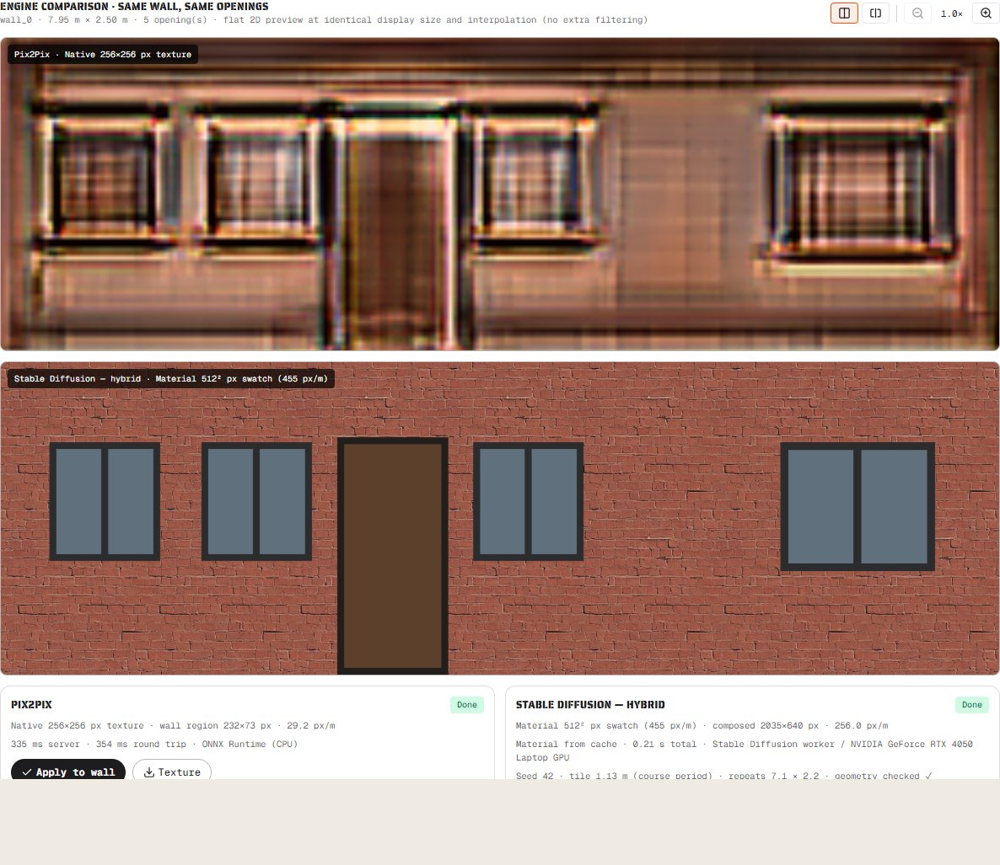
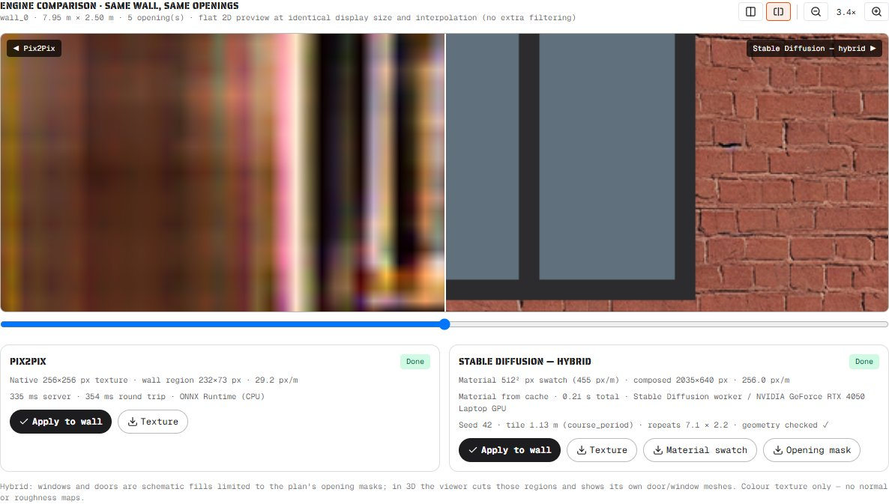
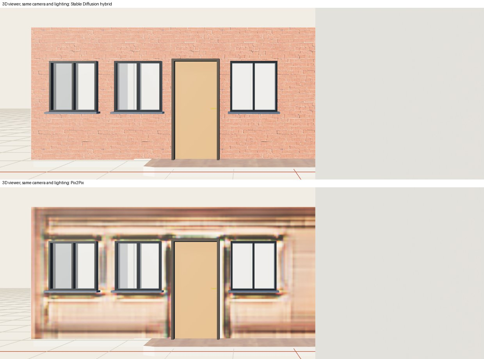
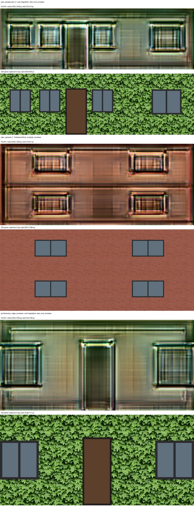
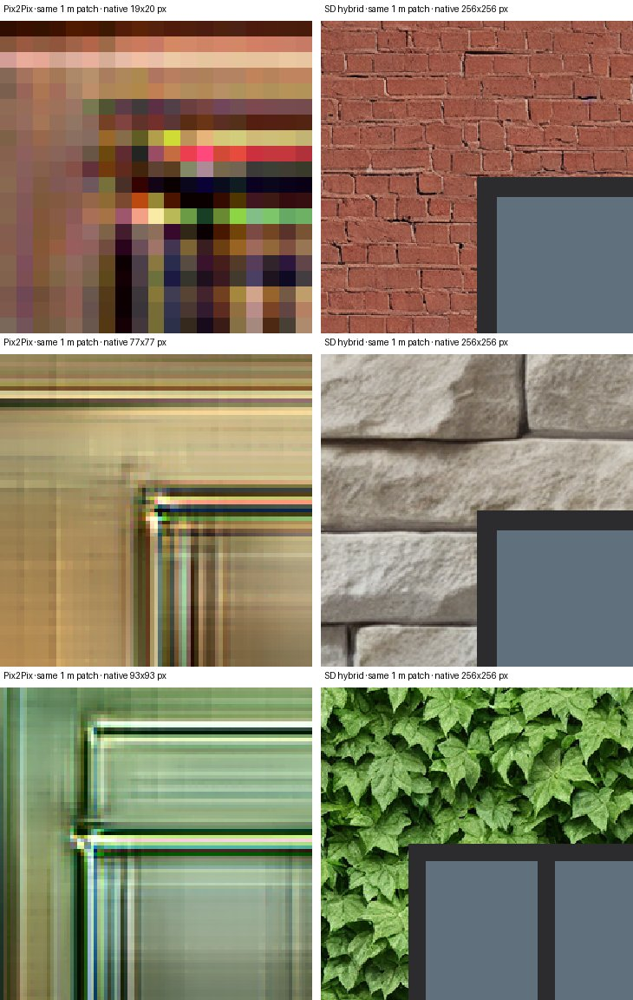
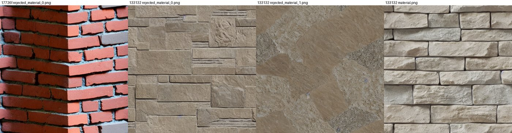

# Façades : Pix2Pix vs « Stable Diffusion — hybride »

Stable Diffusion génère **uniquement un échantillon de matériau** carré et raccordable.
La géométrie du plan reste la seule source des dimensions du mur et des ouvertures :
masques, coordonnées UV et composition sont calculés par le code, puis vérifiés.
Pix2Pix reste disponible tel quel comme référence.

Toutes les valeurs ci-dessous proviennent des exécutions du 15/11/2026 sur la pile Docker
(RTX 4050 Laptop 6 Go, 32 Go RAM, VM Docker 15,5 Go). Les sorties complètes sont dans
`outputs/facade_engine_comparison/` et dans l'expérience MLflow `facade-engine-comparison`.

## Lancement

```powershell
# Pile complète (inchangée) — ajoute le worker SD et télécharge ses poids une seule fois
.\scripts\start_docker_stack.ps1
# Application : http://localhost:3000/#studio → AI Generative Studio → Facades
```

Premier démarrage : téléchargement épinglé et vérifié SHA-256 de ~2,1 Go (8 min 52 s
mesurées ici) dans le volume `facade_diffusion_models`. Les démarrages suivants ne
re-téléchargent rien (vérifié). Vérifications reproductibles :

```powershell
.\.venv\Scripts\python.exe -m pytest tests/test_facade_hybrid.py -q
.\.venv\Scripts\python.exe scripts/evaluate_facade_engines.py --split tuning
.\.venv\Scripts\python.exe scripts/evaluate_facade_engines.py --split final --seeds 6
node scripts/verify_facade_engines_ui.cjs frontend/public/sample_floorplan.png
.\.venv\Scripts\python.exe scripts/verify_gpu_concurrency.py 3
```

## Architecture

```text
Plan → /predict/floorplan (inchangé) → studio : choix du mur
  → charge utile du mur (fitHouseOpenings, identique pour les deux moteurs)
  ├─ Pix2Pix : POST /facade/generate (inchangé, + durée et résolution native)
  └─ Hybride : POST /facade/hybrid/jobs (asynchrone, 202) → GET …/jobs/{id}
        API (CPU) : wall_spec → masques exacts en mètres (refus si géométrie invalide)
        worker facade-diffusion (CUDA) : matériau SD 1.5 512², padding circulaire,
            contrôles automatiques, jusqu'à 3 graines, cache persistant
        API : répétition à l'échelle physique → composition → validation géométrique
        → texture couvrant exactement le mur (uv_bounds = [0,1]²) + masque + matériau
```

| Élément | Fichier |
| --- | --- |
| Configuration figée (modèle, révision, SHA-256, prompts, seuils) | `configs/facade_hybrid.json` |
| Géométrie, masques, composition, validation | `src/bridge/facade_hybrid.py` |
| Gabarits d'ouvertures partagés avec Pix2Pix | `src/bridge/facade_bridge.py` (`wall_opening_templates`) |
| Contrôles du matériau, échelle, clé de cache | `src/models/material_diffusion.py` |
| Worker CUDA | `backend/app/facade_diffusion_worker.py`, `docker/facade-diffusion/Dockerfile` |
| Tâches asynchrones + MLflow | `backend/app/facade_hybrid_jobs.py`, `src/models/facade_tracking.py` |
| Interface | `frontend/src/components/FacadeEngineCompare.jsx`, `GenerativeStudio.jsx`, `App.jsx` |

### Choix du modèle

**Stable Diffusion 1.5 fp16** (`stable-diffusion-v1-5/stable-diffusion-v1-5`, révision
`451f4fe1…`, licence CreativeML OpenRAIL-M ; safety checker non téléchargé).
SDXL n'est pas réutilisé : son UNet fp16 pèse à lui seul 5,1 Go, alors que le bureau
Windows et TripoSR occupent déjà ~1,5 Go des 6 Go. SDXL imposerait donc un déchargement
séquentiel (430–630 s par image mesurées sur la machine précédente, voir
`facade-diffusion-experiment.md`) ; il n'a pas été relancé ici et ses poids ne sont pas
présents sur cette machine. SD 1.5 (~2,1 Go) tient entièrement sur le GPU : **aucune
étape d'inférence ne s'exécute sur CPU ou disque**. Entre deux tâches, les poids sont
rangés en RAM CPU pour rendre la VRAM à TripoSR (transfert mesuré : 0,75 s aller, 0,66 s retour).

### Garde-fous

- Verrou GPU partagé (`gpu_lock`, fichier sur volume commun) entre TripoSR et SD.
- Seuil de VRAM libre (3000 Mio) avant chargement, délai par essai (240 s), attente GPU
  bornée (900 s), libération systématique (`pipe.to('cpu')`, `empty_cache`).
- Échec ⇒ tâche `failed` avec type (`gpu_out_of_memory`, `worker_unavailable`,
  `material_quality_gate`, `invalid_geometry`, `timeout`…). **Aucun remplacement par Pix2Pix.**
- Une panne MLflow n'annule pas la génération (statut `tracking: failed` affiché).

## Ce que montre l'interface



- Choix explicite du moteur, bouton « Compare both engines », même mur, mêmes ouvertures,
  même cadrage (zone du mur uniquement), même taille d'affichage et même interpolation.
- Vue côte à côte ou curseur avant/après, zoom synchronisé ×1–×8 avec déplacement.
- Étiquettes de résolution native, durée, appareil, statut et phase (attente GPU,
  génération n/25, contrôle, composition, validation), erreurs typées.
- Appliquer l'un ou l'autre au mur ; télécharger texture, matériau et masque.
- Contrôles réellement disponibles : Pix2Pix = préréglage de style appliqué *après*
  génération (étalonnage couleur) ; hybride = prompt texte SD + graine.



## Jeu de validation

| Split | Contenu | Usage |
| --- | --- | --- |
| tuning | maison de référence, étage bas (9 murs, 18 paires dont 4 styles sur 3 murs) | inspection des prompts/seuils |
| final | maison de référence étage haut (6), 4 plans analysés (7 murs), 4 murs synthétiques | 17 paires, réglages figés (config SHA `1d35d37e…`), graine 42 |
| seeds | 4 styles × 6 graines sur un mur sans ouverture | robustesse, cohérence de style |

Le jeu final couvre : sans ouverture (5), une fenêtre (3), une porte (1), plusieurs
fenêtres (5), porte + fenêtres (3) ; ouvertures touchant le bord (4 murs à 0 m de marge) ;
1, 2 et 3 étages ; murs de 1,63 à 14 m ; les quatre styles. Aucune modification n'a été
faite après le split tuning (le gris du style minimaliste a été observé mais pas corrigé,
pour ne pas ajuster sur les exemples).

## Résultats (split final, hors 2 échauffements)

### 1. Géométrie (automatique)

| | Pix2Pix | Hybride |
| --- | --- | --- |
| Compositions validées | — | **17/17** |
| Écart max ouverture ↔ géométrie | 2,6 cm (médiane 5 mm) — quantification 256 px | **1,95 mm** (arrondi pixel à 256 px/m) |
| Ouvertures supprimées / ajoutées | 0 / 0 | 0 / 0 (vérifié pixel par pixel) |
| Pixels modifiés hors masques | non applicable (Pix2Pix redessine tout) | 0 |

En 3D, les deux moteurs utilisent les mêmes maillages de portes et fenêtres ; Pix2Pix
ajoute des cadres flous fantômes autour d'eux :



### 2. Qualité visuelle et netteté




Résolution (descriptive, pas une preuve de qualité) : Pix2Pix 16,6–93 px/m sur le mur
(médiane 38,7), hybride 256 px/m. Évaluation visuelle par l'assistant selon la grille du
kit d'aveugle — **non aveugle**, un seul évaluateur, à confirmer par l'équipe :

- Hybride meilleur : briques, joints de pierre et feuilles lisibles ; pas de flou ni des
  artefacts de damier/halos colorés de Pix2Pix ; les styles produisent de vrais matériaux
  alors que Pix2Pix ne change que la teinte d'une même image.
- Hybride moins bon : en 2D, portes et fenêtres sont des aplats schématiques (Pix2Pix
  dessine des menuiseries, floues mais plausibles) ; aucun encadrement, appui, corniche
  ni soubassement ; l'éclairage du viewer (ACES) délave la brique.

### 3. Raccords, répétitions, échelle

- Raccord mesuré (saut au bord / 99e centile des sauts internes) : max 0,93, moyenne 0,70
  (< 1 = raccord invisible numériquement), grâce au padding circulaire UNet + VAE.
- Échelle : 9/17 mesurées par période des assises (brique 0,075 m, pierre 0,30 m par
  assise), 8/17 supposées (enduit 1,0 m, lierre 1,2 m). Densité isotrope : aucun étirement.
- **Répétition visible** : tuile de 1,0–2,7 m répétée jusqu'à 12,5 fois sur un mur ; les
  défauts marquants (joints fissurés de la brique) se répètent de façon reconnaissable.

### 4. Cohérence des styles (24 graines)

| Style | RVB moyen | Tuile (m) | Essais rejetés |
| --- | --- | --- | --- |
| Traditional Brick | 141, 94, 82 | 0,45–1,65 (mesurée) | 2 |
| Mediterranean Stone | 146, 139, 129 | 1,2–3,3 (mesurée) | 5 |
| Modern Minimalist | 159, 157, 153 | 1,0 (supposée) | 3 |
| Lush Vegetation | 88, 127, 59 | 1,2 (supposée) | 1 |

Écart-type des moyennes RVB entre graines : 4–10 niveaux. Limite : l'enduit
« off-white » sort gris moyen. Les rejets sont justifiés à l'inspection : coin de bâtiment
en perspective (malgré le prompt négatif), pierres en diagonale, sculpture.



### 5. Latence, mémoire, échecs

| | Pix2Pix (ONNX CPU, Docker) | Hybride |
| --- | --- | --- |
| Génération | 119 ms médiane serveur (P95 239) | 5,3 s SD (P95 6,5), 25 pas |
| Total client | 0,14 s | 7,8 s médiane, 25,0 s P95 (essais rejetés, surtout pierre) |
| Cache matériau | — | 0,25 s (texture recomposée) |
| VRAM | — | 2805 Mio alloués, 3258 réservés ; appareil 5,4 Go / 6,1 en pic, 1,1 Go au repos |
| RAM worker | — | ~3,9 Go RSS |
| Échecs | 0/17 | 0/17 tâches ; 10 essais rejetés par les contrôles (+11 sur 24 graines) |

Concurrence (`verify_gpu_concurrency.py 3`) : la tâche SD attend 3,6 s en
`waiting_gpu` pendant TripoSR, puis aboutit ; pic appareil 5074/6141 Mio ; TripoSR
continue de passer son propre budget de 3500 Mio. Lors d'un premier essai à froid
(décalage 1 s), SD a obtenu le verrou immédiatement alors que la requête TripoSR durait
34 s : non expliqué avec certitude (probablement du travail TripoSR hors section
verrouillée au démarrage) ; pic 4910 Mio, sans erreur.

Panne du worker (conteneur arrêté) : statut `unreachable`, tâche `failed /
worker_unavailable` sans texture, Pix2Pix répond toujours (HTTP 200).

## Parcours vérifié dans l'interface réelle (Docker, Chrome headless)

Import de plan → studio → choix du mur → comparaison des deux moteurs → zoom et curseur
→ téléchargements PNG (256² et 2035×640) → application de chaque texture et capture 3D à
la même caméra → texture hybride sur un second mur, Pix2Pix conservé sur le premier →
changement d'étages pendant une génération : avertissement immédiat puis résultat
« Discarded ». Captures et rapports dans `outputs/facade_engine_ui/` et MLflow.

## MLflow

Expérience `facade-engine-comparison` : une exécution par génération studio (Pix2Pix
et hybride), par paire d'évaluation, plus un résumé par split, les tests UI et de
concurrence. Paramètres : moteur, modèle, révision, version du code, mur, dimensions,
ouvertures, empreinte d'entrée, prompts, graine, scheduler, pas, guidance, résolution,
GPU, précision, déchargement. Métriques : temps de transfert/génération/composition/
validation, VRAM, RSS, raccords, erreur de masque, rejets. Artefacts : entrée, masque,
matériau, matériaux rejetés, textures, comparaisons, captures 3D, rapports. Les
échauffements sont étiquetés `warmup=true` et exclus des statistiques.

## Limites et vérifications non exécutées

- Pas de cartes PBR : texture couleur uniquement ; l'éclairage est en partie « cuit ».
- Les contrôles automatiques ne prouvent pas l'absence de fenêtres ou d'objets ; ils ont
  rejeté les cas observés, mais l'inspection visuelle reste nécessaire.
- Répétition visible d'une tuile unique ; pas de variation stochastique ni de blending.
- Ouvertures 2D schématiques ; pas d'encadrements, appuis, corniches ou soubassements.
- Géométries héritées de la détection : sur les plans « loft » et « narrow », les murs
  extérieurs détectés n'ont aucune ouverture. Les géométries invalides (ouverture hors
  mur, chevauchement) sont refusées en 422 avec la liste des problèmes, là où Pix2Pix les
  tronquait silencieusement ; aucun cas de ce type dans ce jeu.
- Évaluation perceptive non aveugle et à un seul évaluateur : le kit
  `outputs/facade_engine_comparison/final-*/blind_review/index.html` (clé séparée) doit
  être rempli par l'équipe ; les résolutions différentes restent visibles.
- Aucune métrique appariée (pas de photo de référence) ; aucune supériorité statistique
  revendiquée sur 17 murs.
- Non exécuté : SDXL sur cette machine (raisons ci-dessus) ; démarrage natif hors Docker
  du worker (l'API native renvoie 503 « not configured » sans `ARCHIGEN_FACADE_DIFFUSION_URL`) ;
  test sur une machine sans GPU.
- La VRAM de l'appareil atteint ~5,4 Go sur 6,1 pendant une génération : une autre
  application GPU lourde pourrait provoquer un échec (signalé, pas de repli).
- Les tâches ne survivent pas à un rechargement de page (affichées « Interrupted »).
