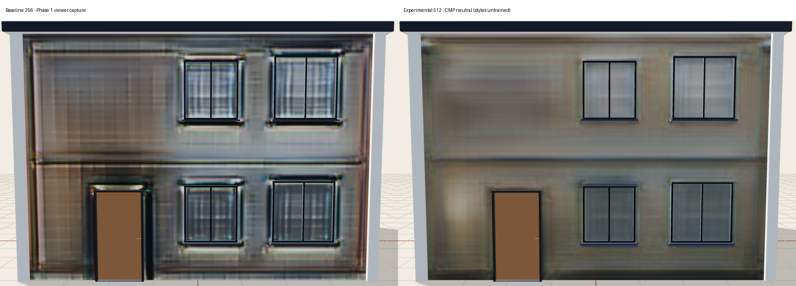
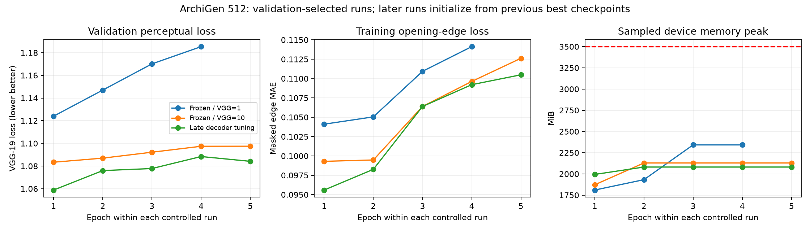

# Facade 512 experiment

Branch: `experiment/facade-photorealism-512`. Recovery checkpoint for the complete
Phase 1 working state: `6a141f3`. Production checkpoints and default inference are
unchanged. This experiment is **not promoted to production**.

## Architecture and data

The pretrained 256 generator supplies a coarse prior. Its encoder and global
bottleneck remain frozen; the selected variant fine-tunes its late decoder.
A new residual U-Net
reads the original 512 semantic map and the upsampled prior, with four residual
bottleneck blocks and FiLM at the bottleneck and all decoder scales. Two independent
style-conditioned discriminators operate at 512 and 256. A zero-initialized output
head makes the initial prediction equal to the prior rather than random noise.

The loss combines hinge GAN, L1 (5), discriminator feature matching (5), frozen
ImageNet VGG-19 (10), and opening-region Sobel/Laplacian matching (5). VGG taps are
relu1_2, relu2_2, relu3_2, relu4_2, relu5_2. Masks locate opening regions; real photo
edges supervise details, so the loss does not invent mullions from rectangle masks.

Original images and index annotations come from the [CMP authors](https://cmp.felk.cvut.cz/~tylecr1/facade/)
under CC BY-SA. `scripts/prepare_cmp512.py` matches original photographs to the
existing 400/100/106 train/validation/test split, requires unambiguous matches,
and rejects source reuse. All 606 images matched; 440 have both axes >=512.
The others have a narrower axis that is upsampled. Do not describe all targets as
native 512x512. The original PNG display palette is **not** the Berkeley training
palette. `src/data/facade_palette.py` records the training-derived encoding.

The legacy bridge confused some semantic classes (cornice/background,
sill/molding, decoration/blind). Only the experiment uses the corrected mapping.
The experimental letterbox uses the real background class outside the wall.

## Style limitations

CMP supplies no labels for the four requested architectural styles. The user chose
to use CMP and report this honestly. Training uses a fifth, neutral embedding.
All four named embeddings exist and have gradient tests, but this checkpoint has
`supported_style_ids: []`. Requests return `style_conditioned: false` and
`effective_style: CMP neutral (unlabelled)`. No heuristic tint is applied. This is
**not evidence of four learned styles**. Add reviewed style IDs (0..3) to training
manifest rows and balanced real examples before training/advertising those styles.

## Reproduce

Install `requirements-facade512.txt` with the appropriate CUDA build of PyTorch.

1. Extract both CMP author archives into `data/raw/cmp_original`.
2. Run `python scripts/prepare_cmp512.py`.
3. Run `python scripts/prepare_vgg19_features.py`. This fetches only the 80 MB
   convolutional part of the timm mirror of torchvision VGG-19 ImageNet weights,
   records the resolved source revision and SHA-256, and avoids an unused 494 MB
   classifier download. An ordinary torchvision VGG-19 checkpoint also works.
4. Ensure other GPU models are unloaded. Run:

   ```powershell
   python -m src.models.facade_experiment --epochs 4 --lambda-vgg 1 --lambda-edges 2
   ```

   Physical batch 2, accumulation 4 (effective 8), FP16 autocast/GradScaler,
   checkpointed residual/VGG layers, initially frozen coarse prior. Optimizer/scaler/RNG
   state is saved in `outputs/phase2/training/last.pth`; resume with `--resume`.
   `best.pth` is selected on validation VGG loss only. Test images never select
   checkpoints. Memory smoke runs must use a separate output directory.

   The initial controlled run used VGG=1 and edges=2. It was stopped after three
   consecutive validation regressions (four completed epochs; best epoch 1).
   The stronger perceptual run initializes from that best checkpoint with fresh
   discriminator/optimizers, and uses a distinct output folder:

   ```powershell
   python -m src.models.facade_experiment --epochs 10 --init-checkpoint outputs/phase2/training/best.pth --output outputs/phase2/training_vgg10
   ```

   Early stopping uses four non-improving validation epochs. Loss weights are
   configurable, recorded in every checkpoint, and must match when resuming.

   `--train-coarse-decoder` optionally fine-tunes up4..up7 and the final convolution
   at one tenth the refiner learning rate. The encoder, global bottleneck, and
   early decoder remain frozen; dropout remains disabled in the pretrained path.
   This tests whether locking the old decoder preserves its grid artifacts.
   Every checkpoint records this option; the original production weights are never modified.

   The selected third run is reproduced with:

   ```powershell
   python -m src.models.facade_experiment --epochs 10 --init-checkpoint outputs/phase2/training_vgg10/best.pth --output outputs/phase2/training_decoder --train-coarse-decoder
   ```

   It early-stopped after five epochs and selected its first epoch. Copy its
   `best.pth` to `models/saved/facade512_experiment/generator.pth` before evaluation/export.

5. `python scripts/evaluate_facade512.py` evaluates all 106 held-out test pairs,
   saves per-image metrics, a paired bootstrap LPIPS interval, raw texture grids,
   and a real-model viewer fixture. Both compared networks receive the same
   semantic input; the 256 baseline is displayed/evaluated at 512 by interpolation.
6. `python scripts/export_facade512.py` exports ONNX with `sketch` and `style_id`
   inputs and checks parity for three style IDs. It never overwrites legacy ONNX.

The allocator cap reserves context/driver headroom. Training checks total device
usage and records allocated/reserved peaks; inference also checks the budget.
These guards abort rather than silently reducing resolution. Total VRAM cannot
be guaranteed against unrelated processes allocating memory between checks.

## Opt-in viewer testing and rollback

```powershell
$env:ARCHIGEN_FACADE_EXPERIMENT = 'models/saved/facade512_experiment/generator.pth'
python -m uvicorn backend.app.main:app --host 127.0.0.1 --port 8000
```

An ONNX path is also accepted; its adjacent JSON metadata must be present. An
invalid experimental path fails explicitly instead of masquerading as a new model.
The frontend uses the returned normalized UV rectangle at either resolution.
Remove the environment variable and restart the backend to restore the production
generator. Do not run GPU training alongside the backend's model warmup.

For browser QA without loading unrelated backend models:

```powershell
$env:ARCHIGEN_FACADE_FIXTURE = 'outputs/phase2/viewer_fixture.json'
$env:ARCHIGEN_VIEWER_OUTPUT = 'outputs/phase2/viewer'
node scripts/verify_phase1_viewer.cjs
```

This exercises the actual React/Three.js viewer with a texture generated by the
checkpoint; floorplan fixtures make roof/UV tests deterministic. It does not claim
to exercise the entire segmentation/API pipeline.

Validation commands:

```powershell
python -m pytest tests/ backend/tests/ -q
cd frontend
npm test
npm run build
```

The dedicated GitHub workflow runs CPU architecture/loss/bridge contracts without
large datasets or model downloads. Full GPU training and trained-weight metrics
are local experiments. Dataset/weights remain outside Git; use existing DVC
storage to share trained artifacts.

## Measured outcome

The checkpoint is **not photorealistic and is not promoted**. It shows modest
held-out gains and fewer strong halos, but the actual viewer remains soft and
retains grid artifacts. Four learned architectural styles are still unsupported.

On all 106 held-out original CMP pairs, compared at 512 resolution with identical
semantic inputs and the production EMA baseline bilinear-upsampled from 256:

| Metric | Production EMA 256 | Experimental 512 |
|---|---:|---:|
| LPIPS ↓ | 0.49887 | 0.49241 |
| SSIM ↑ | 0.33057 | 0.36176 |
| PSNR ↑ | 13.069 dB | 13.329 dB |
| Opening-edge MAE ↓ | 0.10771 | 0.09493 |
| Torchvision Inception KID ×1000 ↓ | 69.944 | 69.616 |

LPIPS improves 1.29%; paired bootstrap 95% interval for experimental-minus-baseline
is [-0.01014, -0.00264]. Opening-edge error falls 11.86%. The small KID change is
descriptive, not a claim of statistical significance. These scores use 512 targets
and must not be compared directly with the repository's earlier 256 benchmark.

79 Python tests passed (all previous 69 plus 10 new); 13 frontend geometry tests
passed; Vite build passed with its existing bundle-size warning. The browser
verified 512 textures, L/T/U/detached roofs, and <=0.01925 px **semantic frame/UV**
alignment. This does not prove that synthesized window details align to that accuracy.
ONNX/PyTorch maximum absolute error: 3.16e-6. The live API returned 512 images and
honest neutral-style metadata. Maximum sampled training VRAM across all runs was
2342 MiB; the selected decoder run peaked at 2081 MiB, below the 3500 MiB guard.



The viewer comparison combines model changes with corrected semantic conditioning,
removal of heuristic tint/sharpening, and anisotropic filtering. The held-out metric
comparison isolates network predictions on the same input. No image was retouched.



Full configurations, checkpoint hashes, per-image metrics, and validation records
are in `models/saved/facade512_experiment/experiment_results.json` and
`test_metrics.json`. The selected PyTorch/ONNX weights and original/prepared data
are DVC-tracked and pushed to the existing `onedrive_backup` remote. No heavy
weights or raw images were added to Git. Retrieve weights with:

```powershell
python -m dvc pull models/saved/facade512_experiment/generator.pth.dvc models/saved/facade512_experiment/generator.onnx.dvc
```

`python scripts/report_facade512.py` regenerates the unretouched comparison and curves.
