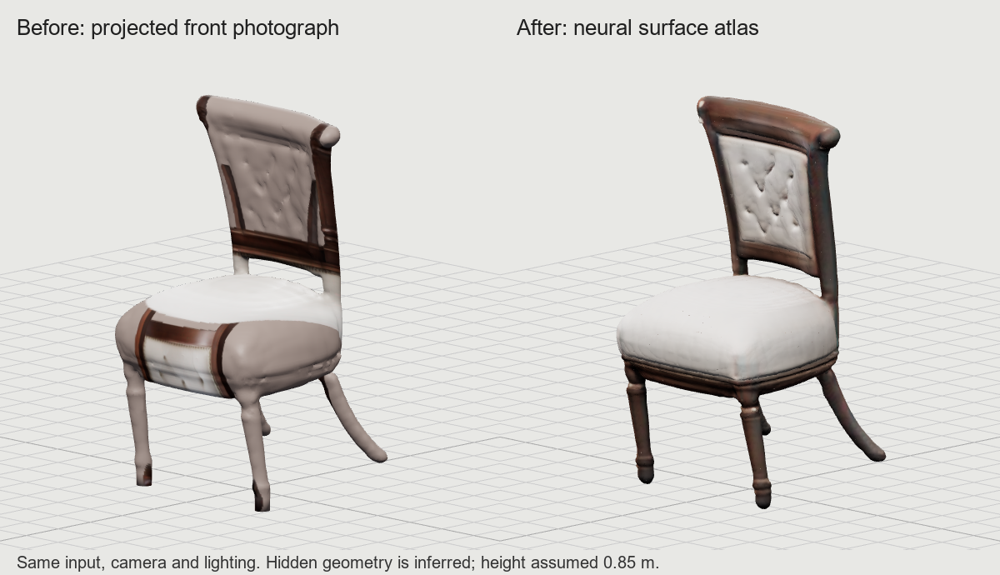

# Furniture reconstruction quality experiment

Branch: `experiment/furniture-reconstruction-quality`, based on facade experiment
commit `791d2b3`. No training or checkpoint replacement was performed. This
experiment recovers the quality of the existing TripoSR neural reconstruction
that the previous extraction and texture projection discarded.

## Changes

- Keep soft alpha and thin parts, crop foreground before the 512 px encoder input,
  and use CPU background removal for opaque photos. The studio now offers an actual
  chair reference instead of flat SVG icons, which Pillow could not decode as photos.
- Extract a canonical XYZ density volume in two-slab batches with 8192-point GPU
  queries. skimage marching cubes returns XYZ directly. The local vendor fallback
  previously swapped axes before querying neural colors; two later swaps happened
  to restore the geometry orientation, but not the field color queries.
- Convert canonical `(X camera-facing, Y right, Z up)` to room `(Y, Z, X)` with
  determinant +1, center the footprint, and use one uniform scale to ground it.
  Do not flatten the lowest 2.5 cm of the legs or apply unconditional smoothing.
- Unwrap with xatlas, rasterize canonical surface positions into an atlas, and query
  TripoSR's color field at those positions. Extend colors into empty atlas texels
  for mipmaps. Remove the hard-coded 20-degree front-photo projection onto all sides.
- Preserve smooth normals across UV seams and the exported GLB material in Three.js.
  Roughness is explicitly a category preset, not a measured PBR texture. Neural colors
  can include illumination; they are not guaranteed intrinsic albedo.
- Strictly load all checkpoint weights. Quality mode raises on failure instead of
  quietly replacing neural reconstruction with a procedural extrusion.
- FP16 encoder/transformer weights and activations; FP32 field decoder and density
  exponential. Serialize generation and singleton construction. Bound PyTorch memory,
  account for other allocations again before inference, sample device memory, and
  clear unused CUDA cache on completion/failure.

## Run locally

This checkout already has CUDA PyTorch 2.6.0+cu124 and the TripoSR source/weights.
The isolated environment inherits those installed packages; it is not a complete
clean-machine environment specification. Do not install the experiment's older
Transformers version into the main project or facade diffusion environment.

```powershell
python -m venv --system-site-packages .venv-furniture-quality
.\.venv-furniture-quality\Scripts\python.exe -m pip install -r requirements-furniture-quality.txt
.\.venv-furniture-quality\Scripts\python.exe scripts/benchmark_furniture_quality.py --mode high --output outputs/furniture_quality/new-run
node scripts/render_furniture_quality.cjs outputs/furniture_quality/new-run/model.glb outputs/furniture_quality/new-run/views
```

For a fresh source checkout, use upstream TripoSR revision
`107cefdc244c39106fa830359024f6a2f1c78871` in the ignored `TripoSR/` directory and
the `stabilityai/TripoSR` config/model checkpoint. The tested checkpoint SHA256 is
`429e2c6b22a0923967459de24d67f05962b235f79cde6b032aa7ed2ffcd970ee`.
Upstream imports torchmcubes even when its extractor is unused. If torchmcubes is
unavailable, apply the tracked import-only patch to a clean upstream checkout:
`git -C TripoSR apply --unidiff-zero --ignore-space-change ../patches/triposr-optional-marching-cubes.patch`.
The existing local vendor tree already has a compatible import fallback; do not
apply the patch on top of it. Quality mode bypasses the vendor extractor and its
modified `from_pretrained`, so neither implementation controls geometry or loading.

With port 8000 free, enable the experiment in a new shell:

```powershell
$env:ARCHIGEN_FURNITURE_QUALITY='1'
$env:ARCHIGEN_FURNITURE_DETAIL='high' # balanced is faster/lighter for room design
$env:ARCHIGEN_FACADE_EXPERIMENT='models/saved/facade512_experiment/generator.pth'
.\.venv-furniture-quality\Scripts\python.exe -m uvicorn backend.app.main:app --host 127.0.0.1 --port 8000
```

Open the existing Vite app on port 3000, select **AI Generative Studio**, and generate
the chair or upload a photograph. Download the GLB or explicitly save it to the room
library. Verification scripts do not write to the library. Unset
`ARCHIGEN_FURNITURE_QUALITY` and restart to use the original implementation.

## Evaluation and limitations

The committed comparison uses the same supplied chair image, a height of 0.85 m,
identical orthographic cameras, lighting and Three.js renderer. Inspect front,
three-quarter, side and back views. There is no paired ground-truth scan, so this
does not establish geometric accuracy or generalization across furniture categories.

The old model visibly projects upholstery onto legs and copies the front photograph
across the seat. Neural surface baking fixes that mapping error and gives coherent
wood/upholstery placement around the model. The learned geometry still has irregular
legs, soft details and small texture artifacts. Unseen surfaces remain inferred.
Higher mesh/atlas resolution cannot supply knowledge absent from the checkpoint.

Presets: balanced = 256 cubed density / 1024 px atlas; high = 384 cubed density /
2048 px atlas. The initial balanced chair had 83,238 triangles; the initial high run
had 189,068. High-detail GLBs are dense (about 8 MB for this chair); use balanced for
many-item rooms until decimated LODs are validated.

Initial standalone runs with FP32 weights plus autocast peaked around 2,750 MiB,
but the full studio exposed an allocation failure with resident floorplan models.
The final implementation uses FP16 large-model weights as well. See the accompanying
results JSON for final end-to-end measurements and validation. Device memory is
sampled, not continuously traced; unrelated GPU processes can change availability.

The next quality ceiling is the learned prior and missing views, not output pixel
count. Evaluate a diverse set of real chairs/tables/sofas and add measured or multi-view
references before claiming production fidelity. Larger candidates have published
requirements beyond this laptop: Hunyuan3D 2.1 lists 10 GB for shape generation and
TRELLIS.2 lists at least 24 GB. They were researched, not installed or benchmarked.
Sources: https://github.com/Tencent-Hunyuan/Hunyuan3D-2.1 and
https://github.com/microsoft/TRELLIS.2.

## Verification

`python -m pytest tests/ backend/tests/`, `npm test`, `npm run build`, and the actual
studio/API smoke test (`node scripts/verify_furniture_studio.cjs`). GitHub Actions
checks analytic geometry, coordinate/catalog contracts and the frontend without
requiring model weights or a GPU. It does not evaluate learned reconstruction quality.

## Verified final result

The actual studio request returned a watertight, one-component chair with 189,116
triangles and a 2048 px texture. Generation took 282.7 seconds; the sampled total
GPU peak was 1,659 MiB, PyTorch peak allocated memory 1,453.6 MiB, and peak reserved
memory 1,564 MiB with the floorplan models resident. Export size: 8,176,096 bytes.
The height is 0.85 m and inferred footprint approximately 0.452 x 0.473 m.

All 104 Python tests, 13 frontend tests, the production frontend build, actual
studio/API generation and four-view GLB rendering passed. GitHub contracts passed
for commit `8afdae7`. The build retains the existing large-JavaScript-chunk warning.



[Four-view comparison](assets/furniture-quality/multiview.png) and
[machine-readable evidence](furniture-quality-results.json).

The final small follow-up moves FP16 casting onto the CPU before GPU transfer to
avoid a transient FP32 weight allocation. It does not change the selected precision
or checkpoint. GPU inference evidence above is from commit `8afdae7`.
