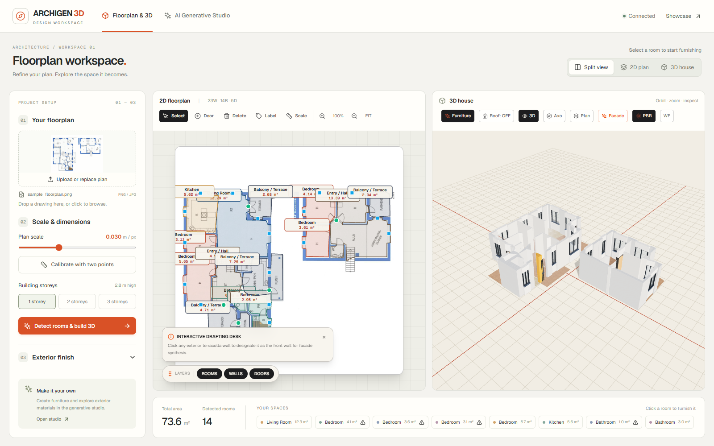
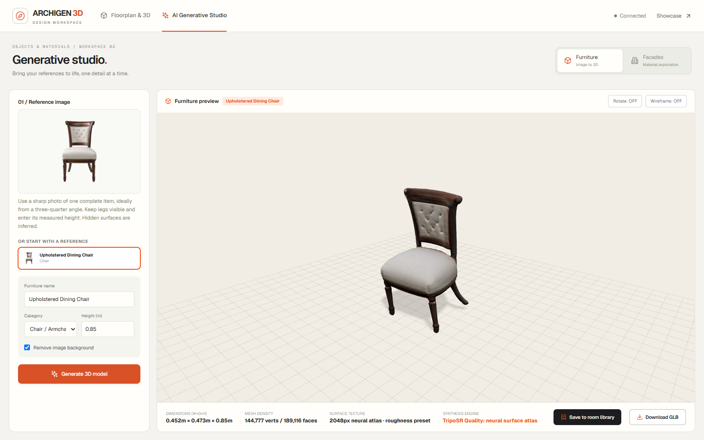
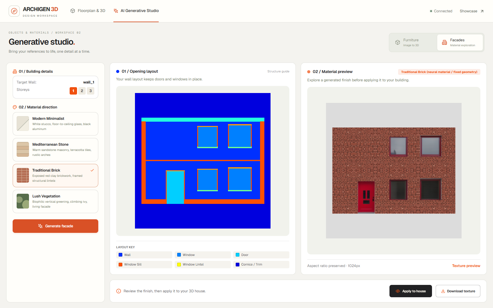

# Workspace interface refresh

Branch: `experiment/studio-interface-design`, based on `5b32a0a`.

The showcase/hero page and its assets are unchanged. Workspace styling lives in
`frontend/src/workspace.css`; it uses workspace-specific classes. The only body
overflow override requires a mounted `.design-app` and a narrow viewport.

## Floorplan and house

- A shared navigation header separates floorplan work from generative tools.
- Project setup follows upload, calibration/dimensions, and an expandable exterior
  finish section. Upload supports file selection and drag-and-drop.
- Split, 2D and 3D views sit beside the page heading. Toolbars wrap instead of
  hiding controls behind horizontal scrolling.
- A compact area/room summary gives more space to the canvases. Room chips open
  the existing room design panel and retain area warnings.
- The existing roof, camera, furniture visibility, wall editing and calibration
  controls remain connected to their original behavior.

## Furniture and facades

- Consistent sidebar, preview and result layouts; readable form labels, material
  swatches, clearer empty states, and focus indicators.
- Furniture controls retain image upload, category/height, generation, preview,
  download and save-to-library actions. The renderer observes its container size
  so responsive changes do not stretch its canvas.
- Facade navigation and material selection no longer trigger generation implicitly.
  The generate button starts it explicitly. The preview identifies the generated
  material, which may differ from a newly selected input style.
- Generation errors appear inline and can be dismissed or retried. Applying a
  facade requires a loaded floorplan and a completed texture.
- At narrow widths, settings and canvases stack and the page scrolls vertically.

## Validation

- `npm test`: all 13 roof and facade geometry tests passed.
- `npm run build`: passed; the existing large bundle warning remains.
- `node scripts/verify_workspace_design.cjs`: real browser checks at 1600, 1366,
  768 and 390 pixels. No horizontal page overflow or uncaught browser errors.
- Verified view switching, room selection, roof controls, generation-error retry,
  furniture GLB display, facade preview/application, and mobile scrolling.
- The browser script uses live floorplan detection and recorded furniture/facade
  outputs to test the interface without repeating expensive model generation.
  The facade fixture is the previous neural-material composite experiment; these
  screenshots are design evidence, not a new model-quality evaluation.
- No backend/model code, model weights, user library contents, or hero assets were
  changed. Existing model and house verification scripts use the updated controls.

[Browser check results](workspace-design-verification.json)

