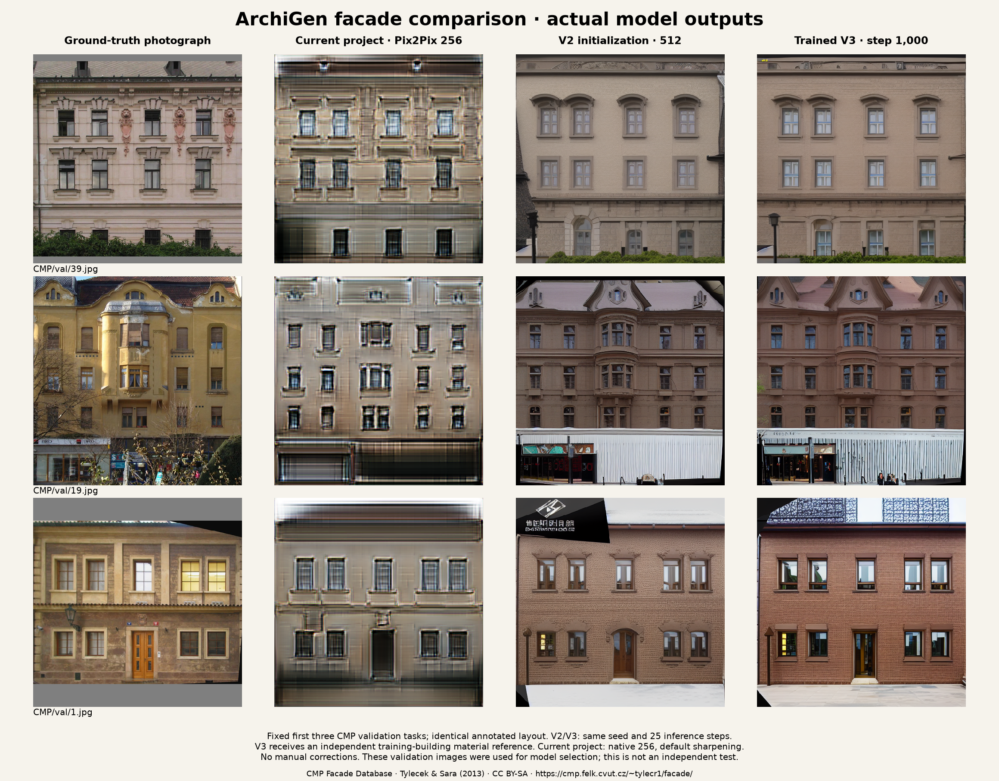

# Completed V3 training and actual image comparison

16 November 2026. Kaggle version **3** finished successfully: **1500 optimizer
updates**, selected **step 1000**, export checksum metadata and fresh-process
offloaded inference passed. Source commit `cd58f59ccd903611f33d7e72b8550d8985be418f`.
Kaggle MLflow source run `8cd8f53cba554535961fde9a48188971` is `FINISHED`.
Imported local MLflow run: `5a354d24198d4a71b3ac2c5c6e78b93f` (`FINISHED`),
including training/validation metric histories and comparison artifacts.
The production application and its weights are unchanged.

The first three saved facade tasks are shown in the predeclared validation
order: CMP `val/39.jpg`, `val/19.jpg`, `val/1.jpg`. The local Pix2Pix was actually
run using the configured production checkpoint (SHA-256
`4d4ec134344564cd7af6c79864f204ff72129dff036c4788b740cf80a7a662bc`), original
12-class masks, native 256 resolution, and default production sharpening.
Its masks match the saved Kaggle targets pixel for pixel after shared cropping
and letterboxing. V2 initialization and trained V3 use the same seeds and 25
inference steps. The figure uses **independent training-building material
references** for V3. Its RGB material input is additional conditioning, so the
image comparison discloses unequal conditioning. There is no manual retouching.

## Results and protocol

The model-selection protocol has **12 CMP + 4 IRF facade tasks**, plus **2 true
blank-wall crops from each source**, each generated under two reference
protocols (40 outputs per checkpoint). These are validation cases used to
select checkpoints, **not an independent test**. Target-wall-reference paired
scores have appearance information extracted from the target photograph.
Independent references come from distinct training buildings; no paired LPIPS
is computed for deliberately mismatched materials. Teacher consistency uses
the same frozen teacher as the training reward and is not independent accuracy.

The table preserves the training protocol's aggregates, including blank crops.
Opening metrics below use the independent-reference protocol.

| Metric | V2 initialization, step 0 | Selected V3, step 1000 |
|---|---:|---:|
| Composite selection score, lower better | 0.5563 | **0.4468** |
| CMP assisted LPIPS, lower better | 0.6776 | **0.6328** |
| IRF assisted LPIPS, lower better | 0.8291 | **0.8140** |
| CMP assisted SSIM, higher better | **0.2107** | 0.1877 |
| IRF assisted SSIM, higher better | **0.2528** | 0.1880 |
| CMP opening IoU from feedback teacher | 71.28% | **77.84%** |
| IRF opening IoU from feedback teacher | 62.36% | **78.14%** |
| CMP wall false-opening rate from feedback teacher | **1.44%** | 1.59% |
| IRF wall false-opening rate from feedback teacher | **0.97%** | 1.46% |
| CMP independent-reference colour MAE, lower better | 0.1614 | **0.1563** |
| IRF independent-reference colour MAE, lower better | 0.1685 | **0.1604** |
| Teacher false-opening rate on four blank-wall tasks | 0.00% | 0.00% |

The selection score improved **19.68%**; assisted aggregate LPIPS improved
**6.62% CMP / 1.83% IRF**. Step 1500 scored 0.4503, so retaining step 1000 was
correct under the declared criterion. This table compares V3 to its V2
initialization, not to the production Pix2Pix model shown in the figure.

For clarity, excluding the four blank-wall tasks gives the following
**facade-only, target-reference-assisted** reconstruction results:

| Dataset / metric | Initial | Selected V3 |
|---|---:|---:|
| CMP LPIPS (12 facades) | 0.5962 | **0.5681** |
| IRF LPIPS (4 facades) | 0.6790 | **0.6605** |
| CMP SSIM | **0.1753** | 0.1749 |
| IRF SSIM | **0.2581** | 0.2242 |
| CMP PSNR, dB | **11.736** | 11.557 |
| IRF PSNR, dB | **9.616** | 9.285 |
| CMP opening-edge MAE | **0.2773** | 0.2882 |
| IRF opening-edge MAE | **0.2308** | 0.2538 |

All aggregates are in [metrics.csv](results/completed-v3/metrics.csv).
All 80 initial/selected per-case records are in
[per-image-metrics.csv](results/completed-v3/per-image-metrics.csv), including
PSNR, task, dataset and reference provenance.

## Visual assessment and remaining limitations

V3 produces much sharper wall and glass detail than the current local Pix2Pix.
Its improvement over the already photographic V2 initialization is smaller:
window interiors and brick texture become clearer in these fixed examples.
However, it invents context such as lamps, people, signage, roof details and
surfaces outside the intended facade. Some geometry and reconstruction metrics
worsened. Blank-crop teacher scores do not establish absence of painted openings
on arbitrary house elevations. Multi-wall consistency remains unverified.

Material-reference response is weak in this pilot. Changing target-derived
references to independent training references changed the first three RGB
reference inputs by mean 42.04 / 36.99 / 38.91 intensity levels (0..255), while
the corresponding generated outputs changed by only 0.22 / 0.35 / 4.77.
This is a three-example sensitivity diagnostic, not a general control benchmark.
The local `material-reference-check.png` shows the actual patches and renders.
Four UI style classes remain unsupervised. Do not describe them as learned.

**Conclusion:** a successfully trained and better-selected experimental
candidate, with visibly sharper outputs, but not a demonstrated solution to
material control, all false openings, or consistent multi-face house textures.
Do not automatically replace production. Next evaluation requires real house
elevations, facade-only cropping/masking, shared material tests, held-out review
and actual laptop inference of the downloaded selected weights.

## Model and reproducibility

- Notebook: https://www.kaggle.com/code/khalilayeb/archigen-facade-material10-feedback-v3-train
- Selected ControlNet SHA-256: `d8365c3c045ee3f4028907bdcbe8a9f9e05aa430f770a94c131595555f4b48ed`.
- Selected LoRA SHA-256: `88375e863323db4c27fa62c3a54f9ee37a8746fb0f86dbe83ccfaa73662ef17e`.
- Kaggle bundle: `archigen-facade-material-v3-model-and-mlflow.zip`.
- Expected archive SHA-256 from Kaggle: `413f3cc1b7b9ef5de8feabca76c1dd1f41c1bf5819d4342ff431769c10219e8a`.
- Fresh-process inference on Kaggle: 512x512, 25 steps, 30.63 s, 913.90 MiB
  peak Torch allocation with CPU offload. This is **not an RTX3050 measurement**.
- The weights ZIP was not downloaded as part of this image/results retrieval;
  the comparison uses saved, actual Kaggle validation outputs. No local V3
  generation or production switch is claimed.

`python -m experiments.facade_material_v3.summarize_completed --artifacts PATH_TO_KAGGLE_RUN --source ORIGINAL_CMP --output NEW_REPORT_FOLDER --project PRIMARY_PROJECT`
reconstructs the shared inputs, verifies exact target alignment, runs the local
production model and creates the figures. Selected-model metadata, runtime
profile, production profile and protocol summary are retained in
`results/completed-v3`. No training code changed during this result analysis.

Ground-truth photographs: CMP Facade Database, Tylecek & Sara (2013), CC BY-SA,
https://cmp.felk.cvut.cz/~tylecr1/facade/. IRFs training reference patches remain
in local research artifacts with source IDs; retain original IRFs/ArchDaily
academic attribution and licensing when using them.
