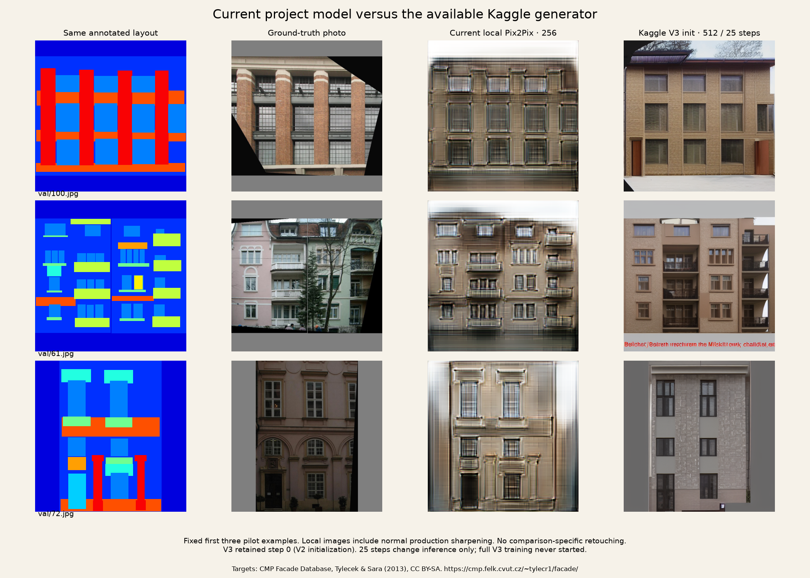

# Current local facade model versus the available Kaggle V3 export

**Historical comparison, before the precision recovery.** Kaggle version 3 has
since passed the teacher gate and begun actual full diffusion optimization;
see [current run status](RUN_STATUS.md). The images and metrics below remain
the original initialization comparison, not the result of that ongoing run.

16 November 2026 (before recovery). **No fully fine-tuned V3 facade generator was available.** The
Kaggle smoke export selected **step 0**, retaining the trained V2 parent and
LoRA, with three zero-initialized material-reference kernels. Full V3 generator
training was blocked by the teacher gate. This compares the available artifact,
not the proposed completed V3 model. The teacher's segmentation IoU is not used
as generator accuracy.

The current project's configured default is the locally trained **Pix2Pix
perceptual-EMA UNet**, `generator_perceptual_ema_best.pth`, at native **256×256**.
It is not `baseline_100ep` or the optional FiLM 512 experiment. The exact primary
project architecture and production CUDA PNG wrapper were loaded, with normal
sharpening enabled and style/material presets off. The checkpoint contains
**39,147,907 generator parameters** and occupies **156.6 MB**.

Both generators received the same original annotated layouts, with each model's
native semantic encoding. The pilot was **16 CMP validation examples**, selected
before generation by fixed seed-42 hash ordering and door/window-count strata.
Shared facade crops and letterboxes were used. Photometric metrics exclude the
letterbox padding. No test images were read. Validation has previously been used
for model selection; this is not an independent generalization benchmark.

The Kaggle export's stored **2-step smoke** setting is reported separately from
a **25-step inference diagnostic using the same weights**. The latter changes
sampling only. Reference channels remain exactly zero, so this checkpoint has
not learned material-reference conditioning. The independent PBR reference does
not provide target-photo information.

Scores at a **common 256×256 evaluation size**, with the same resampler for both:

| Metric | Current Pix2Pix | V3 export / 2 steps | Same V3 init / 25 steps |
|---|---:|---:|---:|
| LPIPS ↓ | **0.4026** | 0.5644 | 0.4581 |
| SSIM ↑ | 0.2027 | **0.2544** | 0.1696 |
| PSNR, dB ↑ | **12.9647** | 12.5880 | 11.9374 |
| Foreground RGB MAE ↓ | **0.1791** | 0.1987 | 0.2070 |
| Opening-region edge MAE ↓ | 0.4005 | **0.2872** | 0.3452 |

Scores at a **common 512×512 evaluation size** (current output upsampled):

| Metric | Current Pix2Pix | V3 export / 2 steps | Same V3 init / 25 steps |
|---|---:|---:|---:|
| LPIPS ↓ | 0.6705 | 0.6637 | **0.5562** |
| SSIM ↑ | 0.2067 | **0.3160** | 0.1968 |
| PSNR, dB ↑ | **12.8669** | 12.4542 | 11.7325 |
| Foreground RGB MAE ↓ | **0.1811** | 0.2018 | 0.2120 |
| Opening-region edge MAE ↓ | 0.3318 | **0.2168** | 0.2831 |

LPIPS values are comparable **within a resolution**, not across resolutions.
The current model has lower LPIPS on 14/16 cases at 256. The paired mean
25-step-minus-current LPIPS difference is +0.0555, with a pilot bootstrap
interval of [+0.0294, +0.0844]. This interval describes this small selected
validation set, not an unseen-building performance guarantee.

The reversal in 512 LPIPS is important: the diffusion initialization produces
sharper photographic texture at its higher native resolution. It still changes
wall materials and can invent doors absent from the semantic layout. Some raw
outputs also generate contextual details/text in unused padding; no such pixels
were manually removed for display. The current model looks blurrier and has
visible texture artifacts. Neither a single metric nor a visually sharper
sample establishes opening correctness or multi-wall material consistency.

The two-step smoke output even scores better on SSIM/edge MAE despite its visible
noise/smoothness. Those metrics measure reference agreement and edge activity;
**edge MAE is not opening IoU or detection accuracy**. No FID/IS is estimated
from this small pilot, and no rejected-teacher IoU is presented as generator
accuracy.

Measured on the same **RTX3050 Laptop GPU**, model load excluded:

| Runtime measure | Current Pix2Pix | V3 / 2 steps | V3 / 25 steps |
|---|---:|---:|---:|
| Median generation seconds | **0.0213** | 3.5189 | 33.4566 |
| Peak Torch allocation, MiB | 211.4 | up to 913.7 across diffusion runs | up to 913.7 across diffusion runs |

The current model ran native FP32 CUDA; diffusion ran FP16 with sequential CPU
offload. The measured 25-step slowdown is about **1,568×** in this local setup.
This is not a cloud/full-GPU diffusion benchmark. Torch allocation is not total
device memory; CPU-offloaded model RAM is additional. Production timing is the
median of three calls per case after warmup. Diffusion uses one fixed seed per
case (42 + pilot index), and no timing includes startup/model downloads.

All raw pilot cases are visible in [the full contact sheet](results/current-v3-comparison/all-pilot-images.png).
The [two-step versus 25-step diagnostic](results/current-v3-comparison/smoke-settings-comparison.png)
shows why the smoke configuration is not a trained quality result. The full
[JSON](results/current-v3-comparison/comparison-metrics.json),
[summary CSV](results/current-v3-comparison/summary-metrics.csv), and
[per-image CSV](results/current-v3-comparison/per-image-metrics.csv) retain both
resolutions and all variants. The figures include CMP ground-truth photos;
they are provided with the dataset's CC BY-SA attribution, rather than as
uncredited project-generated images.

Current checkpoint SHA256:
`4d4ec134344564cd7af6c79864f204ff72129dff036c4788b740cf80a7a662bc`.
V3 export SHA256:
`77314f74f119eeb8d10c8c0c49734d740c9fc4beb1933d684c25baba33697676`.
Its retained initialization was reconstructed from the verified V2 parent;
the resulting safetensors file is **byte-identical to the Kaggle checksum**.
This is not an approximate substitution or a newly trained checkpoint.

Source snapshot: `d063c3a`. Comparison MLflow run:
`67d5cdf712c647749f2bdc917a9cfe53`, experiment
**ArchiGen Facade Production vs V3 Retained Init** in the existing local facade
database. Verification: **131 Python tests passed, 19 skipped**, including a
new shared-input/split-selection check. Production code and weights unchanged.

Reproduce with `python -m experiments.facade_material_v3.compare_current`:
`prepare --project PROJECT --source LOCKED_CMP --output OUTPUT --count 16`,
then `baseline --project PROJECT --output OUTPUT`,
`v3 --model VERIFIED_V3_EXPORT --output OUTPUT`, and
`report --output OUTPUT`. Use the existing diffusion environment for CUDA
generation and an environment with LPIPS/AlexNet for scoring. `reconstruct`
can reproduce only a step-zero export and refuses any checksum mismatch.

Ground truth: [CMP Facade Database](https://cmp.felk.cvut.cz/~tylecr1/facade/),
Radim Tyleček and Radim Šára (2013), CC BY-SA.
