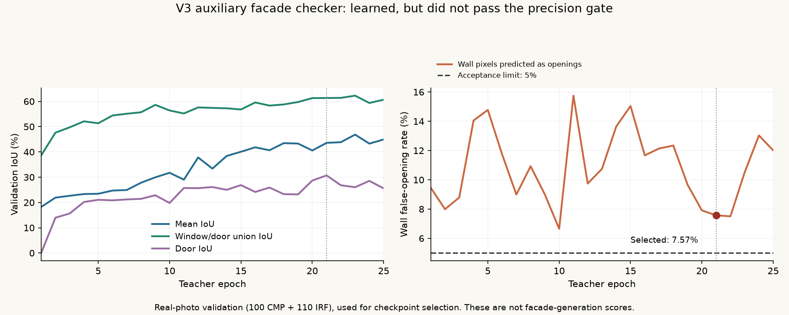

# Submission status — 16 November 2026

**Version 2 executed; the trained teacher failed its declared precision gate.
Full facade fine-tuning did not start. No quality-trained V3 facade export exists.**

## Version 2 outcome

- Complete data audit passed: **1224 training / 210 validation** examples,
  239 genuine blank training crops at audit epoch zero, one unavailable material
  reference explicitly preserved. No test images accessed.
- GPU smoke passed again: two optimizer steps, 16 low-noise feedback
  microbatches, export and fresh-process offloaded inference. Its weights are
  smoke-only and are not an improved facade generator.
- Full teacher completed **25 epochs / 3825 optimizer steps**. Total notebook
  execution was about **70.5 minutes** including audit and smoke.
- Selected teacher checkpoint: **epoch 21**. Scores on 100 CMP + 110 IRF
  validation photos, used for checkpoint selection:

| Gate | Selected score | Requirement | Result |
|---|---:|---:|---|
| Six-class mean IoU | 43.59% | >=30% | Pass |
| Window/door union IoU | 61.33% | >=35% | Pass |
| Door IoU | 30.71% | >=10% | Pass |
| Real wall pixels classified as openings | 7.57% | <=5% | **Fail** |

These are **auxiliary segmentation scores on real photographs**, not generated
facade accuracy or photorealism. None of the 25 epochs met all gates; the
lowest false-opening rate was **6.65%** at epoch 10. The run stopped with
`Teacher failed the predeclared validation gate; diffusion training is blocked`.
The 5% limit was not relaxed and no replacement training was automatically
launched in response to the results question.

Teacher weights were downloaded and SHA-256 verified in the ignored local
`outputs/kaggle-v3-version2/facade-material-v3/teacher` directory. Their metadata,
all 25 epoch metrics, and acceptance checks are preserved in
[the result record](results/kaggle-version2-teacher-results.json).

Portable histories were imported into the existing local facade MLflow DB:

- Full teacher (failed acceptance): `2035db4a7e624e88806e1d5509e9e0e4`
  (Kaggle source `749064adeff54f3b92f09e148c635e8e`).
- Smoke teacher: `a3af1a6632c246ea9c3ee9cf5759770d`.
- Smoke diffusion: `80d75cc860ba4d6b801cd0fb4bbc3b34`.

Production and existing facade checkpoints remain unchanged. The next learned
experiment must improve teacher wall/opening precision before using that
teacher as diffusion feedback; a better overlap score alone is insufficient.

## Earlier version 1 failure

Version 1 did execute. Its GPU smoke passed two optimizer steps, 16 decoded
feedback microbatches, export/checksum validation and fresh-process offloaded
reload. The full teacher then failed before completing its first epoch with
`ValueError: No annotated wall pixels for material reference`. Full facade
fine-tuning therefore never started. This was a loader failure, not a failed
teacher quality gate or a CUDA out-of-memory error.

The loader now uses a wall reference from the same original photo when a crop
has none. If the original annotation also contains no wall, it keeps the
sample, marks the reference unavailable, zeros reference channels and excludes
material loss. Independent references never borrow the target's material.
A complete train/validation sample audit now runs before optimization.

The real local CMP audit passed **399 eligible training + 100 validation
images**, including `CMP/train/242.jpg`, whose reference is unavailable.
No test image was opened. The full CMP+IRFs audit will run on Kaggle.
Evidence: [local audit](results/local-cmp-reference-audit.json) and
[version-1 failure record](results/kaggle-version1-failure.json).

## Submission provenance

- Notebook: <https://www.kaggle.com/code/khalilayeb/archigen-facade-material10-feedback-v3-train>
- Private version 2, source pinned to
  `e02099d6815424959beae6a195eb8e4522cb0e56` on
  `codex/facade-material-controlnet-v3`.
- Requested GPU T4 x2; code uses one GPU. Runtime limit: six hours after
  allocation. Free quota was checked and pay-to-scale is disabled.
- Two earlier smoke-only queued versions were cancelled through Kaggle's
  active-events controls. The replacement is one staged workflow, not parallel
  full training jobs.
- Execution order: isolated two-step smoke → checksum/export/offloaded-reload
  checks → fresh full teacher training/validation gate → diffusion fine-tuning
  → selected model export and portable MLflow bundle.
- Failures in smoke or teacher quality validation stop the remaining workflow.
  The existing production model is never automatically replaced.

## Verified locally

- **130 passed, 19 skipped** in the experiment worktree's complete Python suite.
  Skips are optional dependency/model/data checks unavailable in this checkout.
- **14 passed** in the diffusion environment's V3-specific suite, including
  actual material10 inference/export/reload, initial-response preservation,
  nonzero gradients through a real frozen VAE decoder, protected training
  splits, genuine wall-only crops, and failed-preflight execution gating.
- Source compiles; no whitespace errors. Both production backends remain
  healthy. No production frontend, API default or existing model weights changed.

## Remaining evidence before promotion

An accepted teacher, actual full facade fine-tuning, held-out building/blank-wall
evaluation, and local RTX3050/multi-house tests are still required. The only
diffusion weights produced so far are from the deliberately short smoke test.
