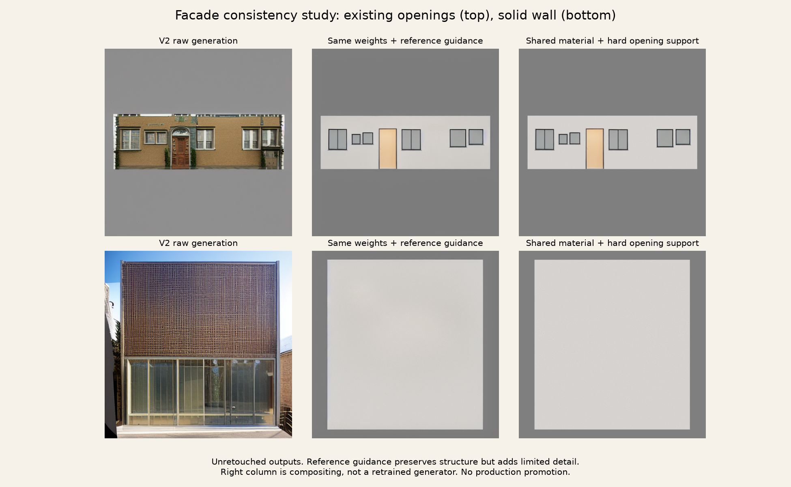

# Local facade constraints study — 15 November 2026

**Outcome:** improved layout/material control on the bundled house, with a
substantial realism tradeoff. No newly trained model, no production promotion,
and no claim that the model now generalizes to arbitrary houses/materials.

The middle column is actual diffusion from an aligned synthetic albedo reference.
It retains blank walls and opening placement, but produces relatively flat
finishes/glazing. The right column uses the material compositor. Its protected
wall consistency is guaranteed by construction, not learned by the network.

## Observations and diagnostic values

| Quantity | V2 raw | Albedo-reference guided | Material lock |
|---|---:|---:|---:|
| Between-panel wall mean RGB dispersion | 32.964 | 2.108 | 0.013 |
| Mean blank-wall Sobel activity | 0.551 | 0.026 | 0.022 |
| Exact protected-pixel agreement with shared material | Not constrained | Not constrained | Maximum error 0 |

RGB dispersion is the root-mean-square Euclidean distance of each wall's mean
sRGB colour from the house-wide mean, excluding measured openings, their
15 cm surroundings, and exterior borders. It is a consistency **proxy** in
texture space; it does not identify materials or measure realism. Sobel activity
is not semantic false-opening detection. The shared material itself has small
nonzero texture variation. The model was not optimized against these proxies.

The two blank panels (`ground_south_extension`, `upper_south`) remain blank in
the raw reference-guided images on visual inspection; their locked outputs are
byte-identical to the PBR base. This is two observations, not a false-positive
rate on an independent test set.

A first trial using lit PBR references had dispersion **45.762**. That result
preserved directional illumination from the input and demonstrates why a
photograph containing shadows is unsuitable as an albedo texture. Both trials
remain in local MLflow; no failed trial was relabelled as a training success.

## Execution and verification

- Exact V2 step-2000 ControlNet and LoRA checksums retained. No weights changed.
- Local RTX 3050, FP16, sequential CPU offload. 25 scheduler steps, strength
  .35: eight active denoising steps. Mean **11.41 seconds/panel**, total batch
  **193.75 seconds** including loading. This is a different protocol from V2's
  25 active text-to-image steps, not a like-for-like model speed benchmark.
- Maximum Torch allocation **909.59 MiB**; device-wide sampled peak
  **1332 MiB**, .5-second sampling. Not an instantaneous peak guarantee.
- Five appearance modes verified in the actual production Viewer3D. All
  **15 skins and 30 physical openings** preserved, unchanged opening positions
  and sizes, no unresolved openings, finite neural opening UVs, and no
  JavaScript/WebGL errors. Maximum facade UV error **9.48e-8**. Optional neural
  pane/leaf detail can be disabled without affecting the physical model.
- Worktree Python suite: **119 passed, 16 skipped**. Optional model/data
  dependencies absent from this checkout cause skips. Five additional checks
  in the diffusion environment all pass, including real tiny-model semantic7
  image-to-image inference. Frontend production build passes, with the existing
  large-bundle warning.
- Both project backends restored after each local generation batch. Main app
  code, default model, and the user's unrelated floorplan/UI edits untouched.

Final albedo-reference MLflow run: `0d1f7555a54142a59f5ab9f0fddd0efc`.
Exploratory lit-reference run: `7271367e85c44b0b82d03e347dd1ae44`.
Experiment: **ArchiGen Facade V3 Inference Constraints**, in the existing local
facade experiment database. Recorded source snapshot: `f321cde0f00614477237495d2049f1235553e95a`.
Complete settings, case/weight checksums, metrics and limitations are in
[the machine-readable result](results/local-albedo-house.json).

## Recommendation

Retain the hard opening/material constraints as a deployment guard. To improve
photographic richness, train the next Kaggle experiment with **material-reference
conditioning**, **validated frozen segmentation feedback**, and **annotated
blank-wall/side-elevation examples**. Compare unseen buildings and real houses,
not only paired LPIPS. That training upgrade is specified in
[the experiment plan](README.md#next-learned-model-experiment-on-kaggle--proposed-not-launched)
and has **not yet been implemented or launched**.
